---

## 👋 About Me

> 🚀 Backend Engineer | Python | Django

I build **production-ready backend systems**, **developer tools**, and **AI-powered platforms**. Author of two PyPI-published CLIs — [djboost](https://pypi.org/project/djboost/) (Django) and [mforege](https://pypi.org/project/mforege/) (AI agent).

- 🏢 Shipped **20+ production projects** for **B2B and B2C** clients across SaaS, e-commerce, healthcare, education, travel booking, eSIM, film streaming, dating, and news portals
- 🌟 Flagship live builds: **Simfrii** (eSIM) · **StreamLab** (AI film) · **Walking Witness** (charity)
- 🔧 Building **[djboost](https://github.com/munjurdev/djboost)** — Django lifecycle CLI (PyPI)
- 🤖 Building **[MForege](https://github.com/munjurdev/MForege)** — AI agent CLI (PyPI)
- 🎬 Building **[CineForge-AI](https://github.com/munjurdev/CineForge-AI)** — local AI video generation
- 📚 Maintaining **[deployment-guide](https://github.com/munjurdev/deployment-guide)** — real-world deployment knowledge
- 🎯 Focus: **Clean Architecture** · **API Design** · **CI/CD** · **Developer Experience**

### 🌱 Currently Exploring

`System Design` `Multi-tenancy` `Event-driven Architecture`

---

## 💻 Tech Stack

| Category | Technologies |
|:---------|:-------------|
| **Backend** | `Python` · `Django` · `Django REST Framework` |
| **Databases** | `PostgreSQL` · `MySQL` |
| **Cache & Messaging** | `Redis` |
| **Background Tasks** | `Celery` · `Celery Beat` |
| **Realtime** | `WebSockets` · `Django Channels` |
| **AI / LLM** | `LLM Agents` · `OpenAI API` · `OpenRouter` · `Ollama` |
| **Integrations** | `Stripe` · `PayPal` · `eSIM Provider APIs` |
| **DevOps & CI/CD** | `Docker` · `Nginx` · `Linux` · `GitHub Actions` · `GitLab CI/CD` |
| **Cloud & Infrastructure** | `AWS` · `Kubernetes` · `Infrastructure as Code` |

---

## 🏢 Production Projects

*Three flagship builds from 20+ production projects I have designed and shipped — backend APIs, payments, and third-party integrations.*

### AlienTek Automation

*Dhaka-based industrial automation and electrical engineering company providing smart, reliable and cost-effective automation solutions for factories and industrial plants.*

<table>
<tr>
<th align="left" width="24%">Project</th>
<th align="left" width="46%">Key Contributions</th>
<th align="left" width="30%">Stack</th>
</tr>
<tr>
<td valign="top">

**[AlienTek Automation](https://alientekautomation.com/)** 
Smart Industrial Automation  

</td>
<td valign="top">

- PLC programming, control panel design, and industrial electrical services
- SCADA & HMI development
- Industrial control panel design
- VFD installation & commissioning
- Machine automation & retrofit
- Maintenance & AMC services
- Industrial automation product supply from global brands (FATEK, Siemens, Schneider, Delta, Omron)

</td>
<td valign="top">

</td>
<td valign="top">

- PLC programming, control panel design, and industrial electrical services
- SCADA & HMI development
- Industrial control panel design
- VFD installation & commissioning
- Machine automation & retrofit
- Maintenance & AMC services

</td>
</tr>
<tr>
<td valign="top">

**[🎬 StreamLab](https://beta.jusb.io/)** 
AI Film Monetization Platform  

</td>
<td valign="top">

- **50+ REST endpoints** for users, content, payments, and platform workflows
- Rent, sell, and subscription models with wallet balances and withdrawals
- **Stripe + PayPal** payments and AWS S3 media storage
- AI features: video generation, image generation, and script analysis

</td>
<td valign="top">

</td>
</tr>
<tr>
<td valign="top">

**[⛪ Walking Witness](https://play.google.com/store/apps/details?id=com.bridgesofglory.app)** 
by Bridges of Glory · Donation & Charity Platform  

</td>
<td valign="top">

- Backend APIs to discover charity projects and make donations
- **Stripe** integration for secure online payment processing
- Donation tracking, transaction history, and financial records
- Secure, scalable APIs for frontend and mobile clients

</td>
<td valign="top">

</td>
</tr>
</table>

---

## 🛠️ Open Source Projects

<table>
<tr>
<td width="50%">

### 🚀 [djboost](https://github.com/munjurdev/djboost)
Production CLI for Django — scaffolding, features, and deployment.

**What it does:**
- Generate production-ready Django projects in seconds
- 17+ modular features (Docker, K8s, Celery, GraphQL)
- Safe add/remove engine with dry-run & auto-rollback

</td>
<td width="50%">

### 🤖 [MForege](https://github.com/munjurdev/MForege)
Personal AI agent CLI — tools, memory, and an IDE-style terminal UI.

**What it does:**
- Agent with file/shell tools, mission plans, and live colored diffs
- Long-term memory, session persistence, and an IDE-style prompt UI
- Pluggable backends: OpenAI, Ollama (local), OpenRouter, any OpenAI-compatible API

</td>
</tr>
<tr>
<td width="50%">

### 💬 [ChatWave](https://github.com/munjurdev/ChatWave)
Real-time messaging platform on Django Channels.

**What it does:**
- Private & group chats over persistent WebSockets (Channels + Redis)
- Voice notes, file sharing, reactions, read receipts, typing indicators
- Email verification, user blocking/reporting, and dark/light themes

</td>
<td width="50%">

### 🎬 [CineForge-AI](https://github.com/munjurdev/CineForge-AI)
Local AI video generation platform — no paid APIs or cloud credits.

**What it does:**
- Prompt-to-video generation with local open-source AI models
- Modular inference adapter (ComfyUI API) in front of a Django app
- Celery + Redis background jobs, FFmpeg processing, GPU-efficient pipeline

</td>
</tr>
<tr>
<td colspan="2" width="100%">

### 📚 [deployment-guide](https://github.com/munjurdev/deployment-guide)
Real-world Django deployment knowledge base.

**What it covers:**
- VPS setup, Django production, Nginx, PostgreSQL
- Docker, Kubernetes, AWS, CI/CD pipelines
- Security hardening, monitoring, troubleshooting

</td>
</tr>
</table>

---

## 📊 GitHub Stats

<table>
<tr>
<td align="center" width="50%">

</td>
<td align="center" width="50%">

</td>
</tr>
</table>

---

## 🔥 GitHub Streak

---

## 📈 Activity Graph

---

## 📫 Connect With Me

<!-- Website badge parked until munjurdev.com resolves:

-->

### 💼 Let's Work Together!

I'm currently **open to freelance projects**, **full-time opportunities**, and **open-source collaborations**.

Feel free to reach out — I'd love to hear from you!

---

*"Clean code, solid architecture, reliable systems."*

